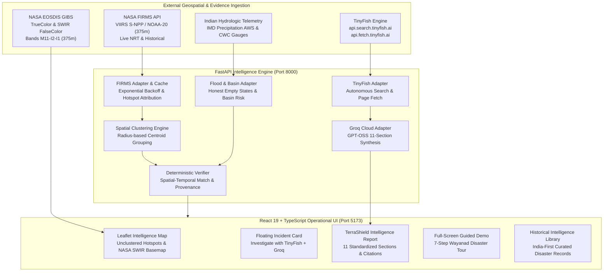

# 🛡️ TerraShield AI — India-First Multi-Hazard Intelligence Platform
## Wildfire + Flood + Thermal Imaging + Evidence-Grounded AI

> **TerraShield AI** transforms raw orbital hazard observations into explainable, source-grounded disaster intelligence. Built with an **India-first geospatial focus**, it integrates **NASA FIRMS satellite thermal observations**, **hydrologic flood telemetry**, **NASA GIBS Shortwave Infrared (SWIR) imagery**, **TinyFish autonomous web retrieval**, and **Groq Cloud GPT-OSS source-grounded intelligence synthesis**.

---

## 📌 1. Product Vision & Architecture

TerraShield AI solves the fundamental credibility gap in disaster dashboards:
1. **Satellite Hotspots ≠ Confirmed Wildfires**: Orbital thermal anomalies trigger from industrial flares, stubble burning, and solar glint. TerraShield unclusters individual raw detections by default, explains spatial resolution limits, and requires independent corroborating field evidence.
2. **Floods Are Non-Combustive**: Flood intelligence uses a completely separate pipeline based on IMD precipitation anomalies, CWC river stages, and microwave SAR radar, never conflating fire thermal alerts with inundation.
3. **Transparent Thermal Imaging Hierarchy**:
   - **Level 1 (Operational)**: VIIRS (375m) & MODIS (1km) radiometric attributes (Brightness TI4/TI5, Fire Radiative Power in MW, confidence).
   - **Level 2 (Operational)**: NASA EOSDIS GIBS False-Color Shortwave Infrared (SWIR Bands M11-I2-I1) and Daily True-Color imagery viewer.
   - **Level 3 (Architectural Roadmap)**: FLIR radiometric thermal computer vision honestly disclosed as requiring calibrated 8–14μm infrared datasets rather than misapplying standard RGB models.
4. **Evidence Grounding via TinyFish + Groq Cloud**:
   - One-click **"Investigate with TinyFish + Groq"** retrieves official agency bulletins (NDMA, KSDMA, FSI, IMD) and credentialed journalism.
   - Generates an 11-section **TerraShield Intelligence Report** structured with executive summaries *before* the source-link list.

---

## 🏗️ 2. Architectural Data Flow



---

## 🇮🇳 3. India-First Historical Disaster Library

TerraShield AI includes a curated library of verified real disasters with complete official documentation:

1. **Wayanad Flash Flood & Debris Disaster (Kerala, July 30, 2024)**:
   - 572 mm / 48h extreme precipitation anomaly at Vythiri AWS.
   - 8.2 km channelized debris runout along Iruvanipuzha River destroying Chooralmala bridge.
   - Grounded in KSDMA Situation Reports, IMD bulletins, PIB Defence, and The Hindu field reporting.
2. **Chamoli Glacial Rockslide & Flash Flood (Uttarakhand, Feb 7, 2021)**:
   - Ronti peak rock-ice avalanche triggering Rishi Ganga & Dhauli Ganga flash flood.
   - Tapovan Vishnugad hydel project inundation; verified via GSI, ISRO, and NDMA.
3. **Brahmaputra Basin Severe Monsoon Inundation (Assam, June 2024)**:
   - Severe seasonal flooding across 28 districts and Kaziranga National Park.
   - Verified via ASDMA daily flood bulletins and Central Water Commission (CWC) stage data.
4. **Uttarakhand Western Himalayan Forest Fire Complex (Uttarakhand, May 2024)**:
   - Severe pre-monsoon fires across Garhwal & Kumaon pine forests.
   - Peak satellite FRP exceeding 340 MW; verified via Forest Survey of India (FSI) & MoEFCC.
5. **International Benchmarks**:
   - Donnie Creek Wildfire Complex (British Columbia, Canada, 2023) — 571,000 ha burn area.
   - Tunnel 5 Columbia River Gorge Fire (Washington/Oregon, USA, 2023).

---

## 🔬 4. The 11-Section TerraShield Intelligence Report

When an analyst clicks **"Investigate with TinyFish + Groq"**, the system executes end-to-end evidence discovery and synthesizes a structured intelligence report presented *before* the source records:

1. **Executive Summary**: High-level synthesis of verified facts and root causes.
2. **What Happened**: Clear physical description of event initiation and progression.
3. **Location and Geographic Context**: Administrative hierarchy, river basin / ecozone, and centroid coordinates.
4. **Event Timeline**: Chronological milestone progression with source attribution.
5. **Satellite and Thermal Observations**: Radiative energy (FRP), brightness temperature, and sensor footprint limitations.
6. **Official Warnings and Independent Corroboration**: Warnings from IMD, SDMAs, and credentialed journalists.
7. **Documented Impacts**: Quantified casualties, displacement figures, infrastructure loss, and environmental damage.
8. **Response and Mitigation Updates**: Armed forces, NDRF, SDRF, and civil relief coordination.
9. **Evidence Assessment**: Spatial-temporal congruence scoring across collected records.
10. **Uncertainties, Conflicting Claims, and Data Limitations**: Revisit latency, cloud cover constraints, and non-authoritative AI boundaries.
11. **Sources and Evidence**: Fully clickable direct links to authentic government bulletins and news articles.

---

## 💻 5. Technology Stack & Dependencies

- **Frontend**:
  - React 19 + TypeScript + Vite
  - Leaflet 1.9 + Esri World Imagery + CARTO Dark Matter + NASA EOSDIS GIBS WMTS
  - Lucide React iconography
  - Custom Dark Geospatial Operational Design System (`index.css`)
- **Backend**:
  - Python 3.12 + FastAPI + Uvicorn
  - Pydantic v2 data models
  - HTTPX asynchronous client with exponential backoff & disk caching
  - Pytest test suite (45 automated tests)

---

## ⚙️ 6. Environment Configuration (`.env`)

Create or update `.env` in the repository root:

```ini
# NASA FIRMS Satellite Fire Telemetry Key (https://firms.modaps.eosdis.nasa.gov/api/map_key/)
NASA_FIRMS_MAP_KEY=your_firms_map_key_here

# TinyFish Autonomous Web Retrieval Key (https://tinyfish.ai)
TINYFISH_API_KEY=your_tinyfish_key_here

# Groq Cloud High-Speed Inference Key (https://console.groq.com/keys)
GROQ_API_KEY=your_groq_api_key_here
GROQ_MODEL=openai/gpt-oss-120b

# Operational Defaults
DATA_MODE=HISTORICAL_SAMPLE
PORT=8000
```

> **Security Guarantee**: All credentials remain strictly server-side. The frontend client never receives secret API keys.

---

## 🏃 7. Running the Platform Locally

### Windows (PowerShell)

```powershell
# 1. Start FastAPI Backend (Port 8000)
python -m uvicorn backend.main:app --host 127.0.0.1 --port 8000

# 2. In a separate terminal, start Vite Frontend (Port 5173)
cd frontend
npm install
npm run dev
```

### Linux / macOS

```bash
# 1. Start FastAPI Backend (Port 8000)
python3 -m uvicorn backend.main:app --host 127.0.0.1 --port 8000

# 2. In a separate terminal, start Vite Frontend (Port 5173)
cd frontend
npm install
npm run dev
```

Visit the operational interface at **`http://localhost:5173`** and the interactive FastAPI OpenAPI documentation at **`http://localhost:8000/docs`**.

---

## 🧪 8. Test Execution & Verification

Run the full automated test suite:

```bash
# Run all backend pytest tests (45 tests)
python -m pytest tests -v

# Run frontend TypeScript typecheck and production build
cd frontend
npm run build
```

### Verified Test Results:
- `tests/test_api.py`: Health checks, detection pagination, incident grouping, and mode switching.
- `tests/test_dossier_and_flood.py`: Honest empty flood states, Wayanad disaster demo, historical search, 11-section report schema, thermal capabilities disclosure, and key masking.
- `tests/test_firms_adapter.py`: Live FIRMS URL construction, HTTP 502 exponential retry backoff, disk caching, and attribute normalization.
- `tests/test_tinyfish_adapter.py`: Domain authority classification, syndication deduplication, and safe error states.
- `tests/test_verifier.py`: Haversine great-circle distance, temporal window constraints, and explainable status verdicts.

---

## ⚠️ 9. Scientific Limitations & Ethical Boundaries

1. **Satellite Latency**: Low-Earth-orbit satellites (VIIRS S-NPP / NOAA-20 / MODIS) observe a location 2–4 times per 24-hour cycle. Detections represent an orbital snapshot, not real-time video surveillance.
2. **Cloud Cover Obscuration**: Monsoon cloud cover frequently obscures optical sensors during peak flash flood events. Microwave radar (Sentinel-1 SAR) and ground automated weather stations (IMD AWS) are required for non-optical verification.
3. **Thermal AI Generalization**: Standard RGB models (such as YOLOv8 trained on COCO) cannot be claimed as functional on radiometric long-wave infrared (LWIR) data without calibrated thermal datasets. TerraShield transparently declares Level 3 thermal CV as an architectural roadmap requirement.
4. **AI Decision Support**: Groq Cloud GPT-OSS provides rapid evidence synthesis and discrepancy analysis. It is an analytical decision-support tool, not an official emergency command authority.
