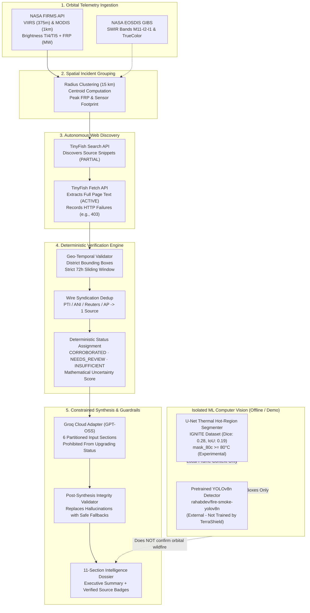

# 🛡️ TerraShield AI — Multi-Hazard Geospatial Intelligence Platform
### *Explainable, Evidence-Grounded Disaster Intelligence from Orbit to Ground*

[](https://www.python.org/)
[](https://fastapi.tiangolo.com/)
[](https://react.dev/)
[](https://www.typescriptlang.org/)
[](https://pytorch.org/)
[](https://github.com/Gagguverse/TerraShield-AI)
[](LICENSE)
[](https://github.com/Gagguverse/TerraShield-AI)

> **TerraShield AI** bridges the credibility gap in automated disaster dashboards by refusing to treat raw satellite thermal anomalies as confirmed ground wildfires. Built with an **India-first geospatial focus**, the platform cross-references **NASA FIRMS orbital radiometry** against autonomous **TinyFish web retrieval** and a **deterministic spatial-temporal verification engine**, synthesizing decision-support dossiers via **Groq Cloud GPT-OSS** while keeping machine-learning computer vision models honestly characterized and isolated from unverified orbital alerts.

---

## 📸 Operational Interface

| Command Overview & ML Suite | Live Orbital Telemetry & Incident Card |
| :---: | :---: |
| .png) | .png) |
| *India overview with 1,500 satellite hotspots, spatial clusters, and ML Analysis Suite.* | *Live orbital pass showing unconfirmed hotspot disclosure and TinyFish trigger.* |

| TinyFish Autonomous Research Audit | Groq Grounded Intelligence Synthesis |
| :---: | :---: |
| .png) | .png) |
| *Audit metrics tracking discovered queries, full-page extractions, and official source badges.* | *Grounded synthesis strictly answering structured questions without status upgrades.* |

| AI Investigation Lifecycle (6 Stages) | NASA EOSDIS GIBS Thermal Satellite |
| :---: | :---: |
| .png) | .png) |
| *Deterministic 6-stage lifecycle from hotspot selection to evidence verification.* | *Global Long-Wave Infrared (11.45 μm) daily composite via NASA EOSDIS GIBS.* |

---

## 📑 Table of Contents

1. [The Problem & Core Value](#-1-the-problem--core-value)
2. [End-to-End Intelligence Pipeline](#-2-end-to-end-intelligence-pipeline)
3. [Operational Feature Matrix](#-3-operational-feature-matrix)
4. [TinyFish Integration — Autonomous Evidence Retrieval](#-4-tinyfish-integration--autonomous-evidence-retrieval)
5. [Evidence Integrity & Verification Engine](#-5-evidence-integrity--verification-engine)
6. [Machine Learning & Computer Vision (Honest Disclosure)](#-6-machine-learning--computer-vision-honest-disclosure)
7. [Historical Disaster Library](#-7-historical-disaster-library)
8. [System Architecture & Technology Stack](#-8-system-architecture--technology-stack)
9. [Automated Verification & Test Results](#-9-automated-verification--test-results)
10. [Quick Start & Installation](#-10-quick-start--installation)
11. [Scope, Known Limitations & Roadmap](#-11-scope-known-limitations--roadmap)
12. [Credits & Provenance](#-12-credits--provenance)


---

## 🎯 1. The Problem & Core Value

Traditional disaster monitoring systems suffer from three fundamental engineering vulnerabilities:

1. **Satellite Hotspots $\neq$ Ground Wildfires**:
   Orbital sensors register thermal anomalies caused by refinery flaring, seasonal stubble burning, and solar reflections off greenhouses or water bodies. Existing dashboards cluster these into "confirmed fires" without ground verification. TerraShield unclusters detections by default, discloses sensor footprint constraints (VIIRS 375m, MODIS 1km), and labels satellite-only anomalies as **Unconfirmed Wildfires** until independent field corroboration is established.

2. **Wildfires and Floods Are Operationally Incompatible**:
   Hydrologic inundations are non-combustive and cannot be detected via thermal sensors. TerraShield completely separates wildfire radiometry from hydrologic flood monitoring, utilizing distinct data models and providing honest empty states rather than conflating thermal data with flood warnings.

3. **Hallucination & Provenance Drift in AI Reports**:
   Unconstrained LLMs frequently invent casualties, misattribute historical articles to live incidents, or declare an event "corroborated" from a single unverified blog post. TerraShield uses a **deterministic rule engine** to establish verification status *before* Groq synthesizes the dossier, enforcing a 72-hour sliding window, administrative district validation, and wire-service syndication deduplication.

---

## 🔄 2. End-to-End Intelligence Pipeline

The platform enforces a strict unidirectional pipeline where **deterministic rules govern verification status**, and AI provides structured summarization:



---

## 📊 3. Operational Feature Matrix

Every feature is classified by its actual runtime implementation status:

| Capability | Status | Description | Primary File / API |
| :--- | :---: | :--- | :--- |
| **NASA FIRMS Hotspot Fetching** | `LIVE` | Fetches VIIRS (375m) and MODIS (1km) thermal anomalies across India and global regions with exponential retry backoff and local disk caching. | [`backend/adapters/firms_adapter.py`](backend/adapters/firms_adapter.py) |
| **Interactive Geospatial Map** | `LIVE` | Leaflet map with NASA GIBS False-Color SWIR (Bands M11-I2-I1), NASA True-Color, Esri Satellite, and CARTO Dark Matter basemaps. | [`frontend/src/components/MapComponent.tsx`](frontend/src/components/MapComponent.tsx) |
| **Spatial Incident Grouping** | `LIVE` | 15 km radius spatial clustering calculating incident centroids, peak Fire Radiative Power (MW), and sensor footprint boundaries. | [`backend/engine/clustering.py`](backend/engine/clustering.py) |
| **TinyFish Search & Extraction** | `LIVE` | Autonomous web discovery and full-page text extraction with research audit tracking (discovered, fetched, failed, relevant). | [`backend/adapters/tinyfish_adapter.py`](backend/adapters/tinyfish_adapter.py) |
| **Deterministic Verifier** | `LIVE` | Rule engine enforcing localized district matching, wire syndication deduplication, 72-hour correlation windows, and mathematical scoring. | [`backend/engine/verifier.py`](backend/engine/verifier.py) |
| **Constrained Groq Synthesis** | `LIVE` | 6-partition prompt design preventing status upgrades; automated post-synthesis validation with safe fallback summaries. | [`backend/adapters/groq_adapter.py`](backend/adapters/groq_adapter.py) |
| **U-Net Thermal Segmentation** | `EXPERIMENTAL` | Custom PyTorch U-Net segmenting thermal regions $\ge 80^\circ\text{C}$ on calibrated frames. Baseline model, not production-ready. | [`backend/ml/unet_inference.py`](backend/ml/unet_inference.py) |
| **Pretrained YOLO Detection** | `PRETRAINED` | Runs inference using an externally pretrained YOLOv8n checkpoint (`rahabdev/fire-smoke-yolov8n`). Not trained by TerraShield. | [`backend/ml/yolo_inference.py`](backend/ml/yolo_inference.py) |
| **Historical Disaster Library** | `HISTORICAL` | Curated archive of verified disasters (Wayanad, Chamoli, Brahmaputra, Uttarakhand, Similipal, Bandipur) with official telemetry. | [`backend/data/fixtures.py`](backend/data/fixtures.py) |
| **Flood Hydrologic Intelligence** | `HONEST EMPTY` | Returns honest empty states ("no qualifying flood anomaly") during normal river stages; strictly separated from thermal fire models. | [`backend/adapters/flood_adapter.py`](backend/adapters/flood_adapter.py) |
| **Automated CWC & SAR Pipeline** | `ROADMAP` | Real-time automated ingestion of Central Water Commission telemetry and automated Sentinel-1 SAR microwave flood extent mapping. | Under active design |

---

## 🐟 4. TinyFish Integration — Autonomous Evidence Retrieval

> **Hackathon Requirement & Integration Mission**: Satellite thermal radiometry detects high-temperature infrared anomalies, but **an orbital hotspot alone is not proof of a ground wildfire**. Spaceborne sensors (such as VIIRS 375m and MODIS 1km) regularly trigger on controlled stubble burning, refinery flaring, industrial kilns, and solar reflections off water bodies or greenhouses. 
> 
> **TerraShield AI integrates TinyFish (`api.search.tinyfish.ai` & `api.fetch.tinyfish.ai`) as its autonomous evidence retrieval backbone.** When an orbital thermal cluster is selected, TerraShield autonomously deploys TinyFish to search the public web, discover contemporary local news and emergency bulletins, extract full-text page content, and capture end-to-end provenance for deterministic verification.

---

### 🗺️ Data Flow & Architecture

The following diagram illustrates how raw NASA orbital telemetry is transformed into an explainable intelligence report through TinyFish autonomous retrieval, deterministic rule checking, and constrained Groq synthesis:

```mermaid
flowchart TD
    subgraph Space["1. Spaceborne Telemetry Ingestion"]
        FIRMS["NASA FIRMS API<br/>VIIRS (375m) & MODIS (1km)<br/>Lat/Lon, FRP (MW), Brightness TI4/TI5"]
        HOTSPOT["Satellite Thermal Hotspot<br/>⚠️ UNCONFIRMED GROUND STATUS"]
    end

    subgraph Clustering["2. Spatial Incident Centroid"]
        Centroid["15 km Radius Cluster Engine<br/>Centroid Coordinates, District Bounding Box<br/>Observation Date & Hazard Type"]
    end

    subgraph TinyFishIntegration["3. TinyFish Autonomous Evidence Retrieval"]
        QueryGen["Dynamic Query Construction<br/>Localized Region, Hazard & Date"]
        SearchAPI["TinyFish Search API (api.search.tinyfish.ai)<br/>Discovers Up to 6 Candidates (Status: PARTIAL)"]
        FetchAPI["TinyFish Fetch API (api.fetch.tinyfish.ai)<br/>Extracts Full-Text Markdown (Status: ACTIVE)<br/>Logs HTTP 403 / Timeouts (Status: FAILED)"]
        AuditLog["Research Audit Telemetry<br/>Tracks Discovered, Fetched, Failed, Direct & Contextual"]
    end

    subgraph VerificationEngine["4. Deterministic Rule Engine (verifier.py)"]
        GTV["Geo-Temporal Validation<br/>Localized District Match & Strict 72h Sliding Window"]
        WireDedup["Wire Syndication Deduplication<br/>PTI / ANI / Reuters / AP Title Slug -> 1 Source"]
        MathScoring["Mathematical Uncertainty Scoring<br/>CORROBORATED · NEEDS_REVIEW · INSUFFICIENT"]
    end

    subgraph Synthesis["5. Constrained Synthesis & Review"]
        Groq["Groq Cloud Adapter (GPT-OSS)<br/>6-Partition Grounded Prompt<br/>❌ Prohibited From Changing Status"]
        Guard["Post-Synthesis Integrity Validator<br/>Overrides Hallucinations with Safe Fallbacks"]
        HumanReview["Human Emergency Analyst Review<br/>11-Section Dossier + Research Audit Provenance"]
    end

    FIRMS --> HOTSPOT
    HOTSPOT --> Centroid
    Centroid --> QueryGen
    QueryGen --> SearchAPI
    SearchAPI --> FetchAPI
    FetchAPI --> AuditLog
    AuditLog --> GTV
    GTV --> WireDedup
    WireDedup --> MathScoring
    MathScoring --> Groq
    Groq --> Guard
    Guard --> HumanReview
```



---

### 🔄 End-to-End Investigation Lifecycle (The Real 6-Stage Workflow)

Every investigation executed in TerraShield AI traces through an auditable, deterministic 6-stage lifecycle implemented in [`backend/api/routes.py`](backend/api/routes.py) and [`backend/adapters/tinyfish_adapter.py`](backend/adapters/tinyfish_adapter.py):

| Stage | Name | Implementation & Mechanics |
| :---: | :--- | :--- |
| **Stage 1** | **Incident Selection & Hotspot Centroid** | An emergency analyst selects an orbital thermal cluster on the interactive map or incident table. TerraShield extracts the centroid coordinates (latitude/longitude), localized administrative region, peak Fire Radiative Power (MW), and satellite observation timestamp. |
| **Stage 2** | **Dynamic Targeted Query Formulation** | Rather than relying on static or hardcoded query strings, TerraShield dynamically constructs targeted queries using the incident's authentic region, hazard type, and date.<br/>• **Wildfires**: `{clean_region} wildfire forest fire emergency incident {inc_date} official report`<br/>• **Floods**: `{clean_region} flood landslide inundation warning {inc_date} official report`<br/>Broad national terms like "India fire" are avoided to maintain localized administrative relevance. |
| **Stage 3** | **Autonomous Web Discovery (`api.search.tinyfish.ai`)** | The adapter dispatches an authenticated `GET` request with the dynamic query and `X-API-Key`. TinyFish scans public web sources and returns up to 6 candidate search results with snippets, URLs, and site titles. Each discovered item is assigned an initial status of `EvidenceStatus.PARTIAL` because snippets alone do not prove ground containment or verified damage. |
| **Stage 4** | **Full-Page Retrieval & Extraction (`api.fetch.tinyfish.ai`)** | TerraShield prioritizes the top 4 candidate URLs and dispatches a batch `POST` request to the TinyFish Fetch API. The endpoint parses the underlying DOM and extracts clean rendered markdown text. Articles with $>30$ characters of clean content transition to `EvidenceStatus.ACTIVE`. |
| **Stage 5** | **Audit Logging & Provenance Recording** | Every request outcome is recorded in an immutable `research_audit` telemetry dictionary. HTTP errors (e.g., HTTP 403 Forbidden paywalls, anti-bot protections, or network timeouts) are logged in `failed_requests` and marked `EvidenceStatus.FAILED`. Sources outside the top 4 batch remain `EvidenceStatus.PARTIAL` with the explicit note `"Fetch not attempted (outside top-priority fetch batch)"`. |
| **Stage 6** | **Deterministic Verification & Constrained Groq Synthesis** | The deterministic verifier evaluates spatial bounds ($\le 35\text{ km}$ or district name match), temporal alignment ($\le 72\text{-hour}$ window), domain authority, and wire syndication deduplication. Groq Cloud GPT-OSS synthesizes an 11-section intelligence report strictly using the supplied partitioned evidence. **Groq is structurally prohibited from altering or upgrading the verification status.** The human analyst reviews the complete dossier. |

---

### ⚖️ Strict Evidence Semantics: What Counts as What?

To eliminate deceptive claims common in automated dashboards, TerraShield enforces clear semantic boundaries between search results, extracted text, and verified ground evidence:

| Evidence Classification | System Status | Criteria & Runtime Behavior | Operational Impact |
| :--- | :---: | :--- | :--- |
| **Discovered Search Snippet** | `PARTIAL` | An unverified search result returned by `api.search.tinyfish.ai` consisting only of a headline and snippet. Page content has **not** been fetched. | **Cannot corroborate an incident.** Displayed in the research audit as a discovered lead, but carries zero ground verification weight. |
| **Successfully Fetched Page** | `ACTIVE` | A web page successfully fetched and rendered via `api.fetch.tinyfish.ai` returning $>30$ characters of clean markdown text. | Provides full readable context (firefighting deployment, containment percentage, evacuation orders) for downstream NLP extraction. |
| **Relevant Direct Evidence** | `ACTIVE` + Direct Role | Full-text page or official agency advisory matching the localized district/coordinates ($\le 35\text{ km}$), dated within the $72\text{-hour}$ window, and addressing the specific hazard type. | Qualifies toward deterministic incident corroboration. |
| **Historical / Contextual Source** | `ACTIVE` / `PARTIAL` + Context Role | An article matching the region or hazard keywords but published outside the 72-hour window (e.g., reporting on 2021 or 2024 historical fire complexes). | **Strictly prohibited from corroborating a live current incident.** Serves solely as background for fuel types, topography, and seasonal recurrence. |
| **Independent Corroborating Source** | Deduplicated Count | Unique publishing entity. When multiple newspapers (e.g., The Hindu, NDTV, Times of India) syndicate the identical Press Trust of India (PTI) or ANI wire dispatch, title slugs are normalized. | **Counts as ONE independent source**, preventing syndicated wire republishing from artificially inflating corroboration scores. |

---

### 🛡️ Transparent Failure State Disclosures

TerraShield AI never pretends web calls succeeded when credentials or network links fail:

1. **Missing or Invalid `TINYFISH_API_KEY`**:
   - If `TINYFISH_API_KEY` is empty or $<6$ characters, `tinyfish_adapter.is_configured` evaluates to `False`.
   - The investigation endpoint returns `credentials_missing` status with clear instructions directing the operator to configure `.env`.
   - In `DEMO` or `HISTORICAL` mode, TerraShield loads authentic pre-verified benchmark fixtures to demonstrate platform capabilities **without fabricating live web requests or inventing URLs**.
2. **Upstream Network Timeouts & Rate Limits**:
   - TinyFish Search enforces a 14.0-second timeout; Fetch enforces a 16.0-second timeout.
   - If an upstream request times out or triggers HTTP 429 Rate Limiting, the event is appended to `research_audit.failed_requests` and reported to the operator.
3. **Inaccessible Pages & Paywalls (e.g., HTTP 403 Forbidden)**:
   - When news websites block automated extraction via Cloudflare, paywalls, or anti-scraping measures, the exact HTTP status is stored in `last_fetch_errors[url]` and marked `EvidenceStatus.FAILED`.
   - TerraShield displays these failed fetches transparently in the Research Audit UI. It never claims paywalled articles were read or verified.
4. **Zero Matching Sources Discovered**:
   - If TinyFish discovers zero matching ground reports, the incident is deterministically classified as `INSUFFICIENT_EVIDENCE` with an Uncertainty Score of $0.92–0.95$.
   - The UI and report prominently state: *"A spaceborne thermal hotspot indicates radiative energy, but is not, by itself, proof of a ground wildfire. Ground wildfire status remains unconfirmed."*

---

### ⚙️ Practical Setup & Environment Configuration

Configure the TinyFish adapter using environment variables in local development and production deployments.

#### 1. Local Configuration (`.env`)
Create or edit your `.env` file in the repository root using placeholder values:

```env
# ==============================================================================
# TerraShield AI — Environment Configuration
# ==============================================================================

# TinyFish Autonomous Evidence Retrieval Key (Required for live web search & fetch)
# Obtain an authentic API key at: https://www.tinyfish.ai/
TINYFISH_API_KEY=your_tinyfish_key_here

# Groq Cloud API Key (Required for constrained LLM report synthesis)
# Obtain at: https://console.groq.com/keys
GROQ_API_KEY=your_groq_key_here
GROQ_MODEL=openai/gpt-oss-120b

# NASA FIRMS Map Key (Required for live satellite hotspot ingestion)
# Obtain free at: https://firms.modaps.eosdis.nasa.gov/api/map_key/
FIRMS_MAP_KEY=your_firms_key_here

# Application Operating Mode: LIVE, HISTORICAL_SAMPLE, or DEMO
DATA_MODE=LIVE
```

> [!CAUTION]
> **Credential Security**: Never commit real API keys, tokens, or `.env` files to Git. The project `.gitignore` strictly excludes `.env`. The backend adapter incorporates an automated `_mask_key()` filter that redacts API keys from all logged errors and API responses.

#### 2. Cloud Deployment Configuration (Render / Railway / Docker)
When deploying to cloud platforms (such as Render):
1. Navigate to your Web Service dashboard: **Settings** $\rightarrow$ **Environment Variables**.
2. Add the environment key:
   - **Key**: `TINYFISH_API_KEY`
   - **Value**: `your_tinyfish_key_here` (enter your authentic private key).
3. Add companion keys (`GROQ_API_KEY`, `FIRMS_MAP_KEY`) and set `DATA_MODE=LIVE`.
4. Deploy the service. The backend automatically detects the configured keys on startup via `Settings.has_tinyfish_key`.

---

### 🔬 Real-World Investigation Walkthrough Example

The following trace illustrates how TerraShield investigates a live satellite hotspot in the Almora district of Uttarakhand:

1. **Orbital Anomaly Detected**:
   - **Hotspot ID**: `INC-LIVE-015`
   - **Sensor**: VIIRS S-NPP (375m)
   - **Location**: $29.6200^\circ\text{N}, 79.6700^\circ\text{E}$ (Almora District, Uttarakhand)
   - **Telemetry**: Peak Fire Radiative Power (FRP) $48.2\text{ MW}$, Brightness Temperature $344.1\text{ K}$, Confidence: Nominal.
   - **Initial Status**: `UNCONFIRMED_WILDFIRE` (Satellite thermal detection only).
2. **Targeted Query Constructed**:
   - Dynamic query built: `"Almora wildfire forest fire emergency incident 2026-04-18 official report"`
3. **TinyFish Search Dispatches (`api.search.tinyfish.ai`)**:
   - Returns 6 candidate sources (`PARTIAL`):
     - Source 1: *Times of India* — "Forest fire breaks out in Almora pine tract; forest division teams deployed."
     - Source 2: *Uttarakhand Forest Department (forest.uk.gov.in)* — "Vanagni Fire Bulletin: Daily Fire Alert Summary for Almora Circle."
     - Source 3: *The Hindu (PTI Syndication)* — "Wildfire flares in Garhwal-Kumaon hills amid rising heatwave."
     - Source 4: *NDTV (PTI Syndication)* — "Wildfire flares in Garhwal-Kumaon hills amid rising heatwave."
     - Source 5: *Deccan Herald* — "Himachal Shimla forest fire controlled."
     - Source 6: *Environmental Blog* — "Himalayan Forest Fires in 2021: A Retrospective Analysis."
4. **TinyFish Fetch Extracts Content (`api.fetch.tinyfish.ai`)**:
   - Sources 1 & 2: Successfully fetched and parsed into clean markdown ($>300$ words). Marked `EvidenceStatus.ACTIVE`.
   - Source 3: Returns HTTP 403 Forbidden due to publisher paywall. Marked `EvidenceStatus.FAILED` with error `HTTP 403 Forbidden`.
   - Source 4: Discovered but outside top-priority fetch batch. Remains `EvidenceStatus.PARTIAL`.
5. **Deterministic Rule Verification (`verifier.py`)**:
   - **Spatial Check**: Sources 1 & 2 match Almora district administrative boundary ($\le 35\text{ km}$). Passed (`GEO_COORDINATE_VALID` + `NAMED_LOCATION_ASSOCIATION`).
   - **Temporal Check**: Published within 14 hours of satellite overpass ($\le 72\text{-hour}$ window). Passed (`TEMPORAL_WINDOW_MATCH`).
   - **Authority Check**: Source 2 is an authentic `.gov.in` domain (`OFFICIAL_AGENCY`). Passed (`OFFICIAL_AGENCY_CORROBORATION`).
   - **Syndication Check**: PTI wire duplicates recognized and deduplicated.
   - **Rejection**: Source 5 rejected (wrong state: Himachal); Source 6 reclassified as contextual background (historical 2021 article).
   - **Deterministic Verdict**: Status assigned: **`CORROBORATED`** (Uncertainty: $0.14$, Confidence: $0.86$).
6. **Constrained Groq Synthesis**:
   - Groq receives the 6 structured context partitions.
   - Synthesizes an 11-section intelligence dossier documenting active suppression operations and quoting the official Forest Department bulletin.
   - Guardrails verify that Groq did not alter the verification status, invent casualties, or hallucinate citations.
7. **Human Emergency Review**:
   - Disaster management operators view the corroborated dossier, verified source links, and full audit breakdown showing exactly which pages were fetched and which failed.

---

## 🛡️ 5. Evidence Integrity & Verification Engine

TerraShield treats evidence provenance and mathematical verification as primary engineering requirements rather than heuristic side effects:

### Core Rules Enforced by [`verifier.py`](backend/engine/verifier.py) & [`geo_temporal_validator.py`](backend/engine/geo_temporal_validator.py)

1. **Snippet vs. Fetched Source Distinction**:
   A search snippet is an unverified discovery record (`EvidenceStatus.PARTIAL`). An article only qualifies as direct ground evidence when its full-text page is successfully fetched and parsed (`EvidenceStatus.ACTIVE`).
2. **Preservation of Fetch Errors**:
   HTTP failures (e.g., 403 Forbidden paywalls, network timeouts) are recorded in the audit log and visibly displayed to analysts instead of being silently ignored.
3. **Syndicated Wire Story Deduplication**:
   When multiple newspapers reprint the exact same news agency dispatch (e.g., Press Trust of India, ANI, Reuters, Associated Press), the engine normalizes title slugs and counts the syndication as **one independent reporting entity**.
4. **Localized Administrative Boundaries**:
   Generic regional or national mentions (e.g., an article referencing "forest fires in India" or "Uttarakhand heatwave") are rejected as direct evidence for a localized fire unless matching specific district bounding boxes (e.g., Pauri Garhwal, Chamoli, Nainital).
5. **Strict 72-Hour Temporal Window**:
   Historical news articles (e.g., reporting on a 2021 or 2024 fire) are categorized strictly as *contextual background* and **cannot corroborate a current incident**.
6. **Mathematical Uncertainty Scoring**:
   Arbitrary confidence constants are replaced with dynamic calculations:
   $$\text{Uncertainty} = \text{clamp}(0.22 - \Delta_{\text{official}} - \Delta_{\text{proximity}} - \Delta_{\text{diversity}}, 0.08, 0.28)$$
   $$\text{Confidence} = 1.0 - \text{Uncertainty}$$
7. **Constrained AI Synthesis**:
   Groq Cloud GPT-OSS receives structured, partitioned context. It is structurally prohibited from altering the deterministic verification status. If an LLM response asserts an ungrounded wildfire for an uncorroborated hotspot, post-synthesis validation automatically replaces the summary with an evidence-grounded fallback.

---

## 🤖 6. Machine Learning & Computer Vision (Honest Disclosure)

TerraShield AI includes an operational ML analysis suite designed for thermal and visible frame inspection. In keeping with engineering honesty, all models and limitations are disclosed:

| Model | Architecture | Checkpoint Provenance | Dataset / Training | Evaluation Status | Honest Limitations |
| :--- | :--- | :--- | :--- | :--- | :--- |
| **U-Net Thermal Segmenter** | PyTorch U-Net (bilinear upsampling, 4.3M params) | `backend/ml/models/unet_ignite_best.pt` | Trained on IGNITE Fire Dataset (`Kyoma001/IGNITE-fire-dataset`, CC BY 4.0) | **Held-out Test Dice: 0.276**<br/>**Held-out Test IoU: 0.194** (Sequence 0004) | **Experimental baseline, NOT production-ready.** Detects thermal hot regions ($\ge 80^\circ\text{C}$, `mask_80c`), which indicate elevated heat, not confirmed wildfires. Zero synthetic temperatures or GPS coordinates are invented. |
| **YOLO Fire & Smoke Detector** | Ultralytics YOLOv8n | `backend/ml/models/yolo_pretrained/best.pt` | Externally pretrained checkpoint (`rahabdev/fire-smoke-yolov8n`, Hugging Face, AGPL-3.0) | **Pretrained Inference Demonstration** (Returns bounding boxes and confidence) | **NOT trained by TerraShield AI.** Detection counts on sample frames illustrate bounding-box mapping and API latency, not generalized model accuracy. |

> **Telemetry Isolation**: Predictions from local computer vision models are strictly separated from NASA FIRMS satellite radiometry. Local frame analysis provides visual context but does not independently verify an orbital hotspot.

---

## 🏛️ 7. Historical Disaster Library

TerraShield AI includes curated dossiers of verified disasters with authentic official documentation to benchmark verification rules:

- **Wayanad Debris Flow & Flash Flood (Kerala, July 30, 2024)**:
  572 mm / 48h extreme precipitation recorded at IMD Vythiri AWS; 8.2 km channelized debris runout along Iruvanipuzha River destroying Chooralmala bridge. Verified via KSDMA Situation Reports, IMD bulletins, PIB Defence, and on-ground journalism.
- **Chamoli Glacial Rockslide & Flash Flood (Uttarakhand, Feb 7, 2021)**:
  Ronti peak rock-ice avalanche triggering Rishi Ganga & Dhauli Ganga flash floods, destroying Tapovan Vishnugad hydel project. Verified via GSI, ISRO, and NDMA records.
- **Brahmaputra Severe Monsoon Inundation (Assam, June 2024)**:
  Seasonal flooding across 28 districts and Kaziranga National Park. Documented through ASDMA bulletins and Central Water Commission river stages.
- **Uttarakhand Forest Fire Complex (May 2024)**:
  Severe pre-monsoon fires across Garhwal and Kumaon pine forests. Peak satellite FRP exceeding 340 MW; verified via Forest Survey of India (FSI) and MoEFCC reports.
- **Similipal Biosphere Reserve Fire (Odisha, March 2021)**:
  High-intensity fires across Mayurbhanj core and buffer zones. Corroborated by Principal Chief Conservator of Forests bulletins.
- **Bandipur Tiger Reserve Fire (Karnataka, Feb 2019)**:
  Over 4,800 hectares of deciduous forest affected. Verified via Karnataka Forest Department and ISRO Bhuvan satellite monitoring.

---

## 💻 8. System Architecture & Technology Stack

```
TerraShield-AI/
├── backend/
│   ├── main.py                     # FastAPI application entrypoint and middleware
│   ├── config.py                   # Pydantic settings and environment variables
│   ├── api/
│   │   └── routes.py               # REST endpoints (FIRMS, TinyFish, Groq, ML, Flood)
│   ├── adapters/
│   │   ├── firms_adapter.py        # NASA FIRMS API client with backoff & caching
│   │   ├── tinyfish_adapter.py     # TinyFish search/fetch client with research audit
│   │   ├── groq_adapter.py         # Constrained Groq Cloud synthesizer with guardrails
│   │   └── flood_adapter.py        # Hydrologic flood adapter and honest empty states
│   ├── engine/
│   │   ├── clustering.py           # Spatial radius clustering & centroid calculation
│   │   ├── verifier.py             # Deterministic verification & syndication dedup
│   │   └── geo_temporal_validator.py # Bounding boxes, district matching & 72h window
│   └── ml/
│       ├── unet.py                 # PyTorch U-Net architecture definition
│       ├── unet_inference.py       # U-Net hot-region segmentation inference
│       └── yolo_inference.py       # Pretrained YOLO fire/smoke detector inference
├── frontend/
│   ├── src/
│   │   ├── components/
│   │   │   ├── MapComponent.tsx    # Leaflet map with NASA SWIR / TrueColor basemaps
│   │   │   ├── TerraShieldReportModal.tsx # 11-section report with audit counters
│   │   │   ├── MLAnalysisPanel.tsx # Floating U-Net mask & YOLO box viewer
│   │   │   ├── IncidentDossierView.tsx # Historical incident archive viewer
│   │   │   └── GuidedDemoView.tsx  # 7-step full-screen Wayanad disaster tour
│   │   ├── index.css               # Dark Geospatial Operational Design System
│   │   └── App.tsx                 # Main application state and layout
│   └── package.json                # React 19 + TypeScript + Vite configuration
└── tests/
    ├── test_api.py                 # API endpoint and health checks (15 tests)
    ├── test_dossier_and_flood.py   # Report schema and flood status checks (12 tests)
    ├── test_evidence_integrity.py  # Verification integrity & edge cases (11 tests)
    ├── test_firms_adapter.py       # NASA FIRMS retries & caching (12 tests)
    ├── test_tinyfish_adapter.py    # TinyFish audit & status transitions (6 tests)
    └── test_verifier.py            # Mathematical scoring & deduplication (7 tests)
```

---

## 🧪 9. Automated Verification & Test Results

The platform has been validated across automated backend unit/integration tests and frontend production builds:

### Automated Backend Test Suite
Executed directly in Python 3.12 via pytest:

```bash
python -m pytest tests -v
```

```
============================= test session starts =============================
platform win32 -- Python 3.12.10, pytest-9.1.1, pluggy-1.6.0
rootdir: F:\screenshots
collected 63 items

tests/test_api.py ...............                                        [ 23%]
tests/test_dossier_and_flood.py ............                             [ 42%]
tests/test_evidence_integrity.py ...........                             [ 60%]
tests/test_firms_adapter.py ............                                 [ 79%]
tests/test_tinyfish_adapter.py ......                                    [ 88%]
tests/test_verifier.py .......                                           [100%]

======================= 63 passed, 1 warning in 35.86s ========================
```

- **`test_evidence_integrity.py` (11 tests)**: Validates that zero successful fetches cannot corroborate, wire syndications count as one source, out-of-bounds locations are rejected, historical articles cannot corroborate current events, Groq guardrails catch hallucinations, and satellite-only anomalies disclose unconfirmed ground status.
- **`test_api.py` (15 tests)**: Validates health checks, incident pagination, data modes, and ML inference endpoints.
- **`test_firms_adapter.py` (12 tests)**: Validates live URL construction, HTTP 502 exponential retry backoff, disk caching, and attribute normalization.
- **`test_dossier_and_flood.py` (12 tests)**: Validates honest empty flood states, 11-section report schema compliance, and API key masking.
- **`test_tinyfish_adapter.py` (6 tests)**: Validates research audit counters, partial vs. active statuses, and HTTP 403 preservation.
- **`test_verifier.py` (7 tests)**: Validates Haversine distance, temporal constraints, and mathematical uncertainty formulas.

### Frontend Production Build
```bash
cd frontend && npm run build
```
```
✓ 2513 modules transformed.
dist/index.html                   0.99 kB
dist/assets/index-BbbFWAi0.css   87.65 kB
dist/assets/index-DVJxiGgm.js   995.41 kB
✓ built in 328ms (0 TypeScript errors)
```

---

## 🚀 10. Quick Start & Installation

### Prerequisites
- **Python 3.12+**
- **Node.js 18+** & **npm**
- **Git**

### 1. Clone the Repository
```bash
git clone https://github.com/Gagguverse/TerraShield-AI.git
cd TerraShield-AI
```

### 2. Backend Setup
```bash
# Create and activate virtual environment
python -m venv venv

# Windows (PowerShell)
.\venv\Scripts\Activate.ps1

# Linux / macOS
source venv/bin/activate

# Install dependencies
pip install -r requirements.txt
```

### 3. Frontend Setup
```bash
cd frontend
npm install
cd ..
```

### 4. Configure Environment
Copy `.env.example` to `.env` in the repository root:
```bash
cp .env.example .env
```
*(See [TinyFish & Environment Configuration](#-4-tinyfish-integration--autonomous-evidence-retrieval) above for configuring API keys. If keys are omitted, the application runs fully in `HISTORICAL_SAMPLE` or `DEMO` mode).*

### 5. Launch Application
In two separate terminals:

```powershell
# Terminal 1: Backend Server (Port 8000)
python -m uvicorn backend.main:app --host 127.0.0.1 --port 8000 --reload

# Terminal 2: Frontend Client (Port 5173)
cd frontend
npm run dev
```

- **Operational UI**: [`http://localhost:5173`](http://localhost:5173)
- **Interactive OpenAPI Docs**: [`http://localhost:8000/docs`](http://localhost:8000/docs)

---

## 🔭 11. Scope, Known Limitations & Roadmap

### Current Operational Capabilities
- Live NASA FIRMS VIIRS & MODIS satellite hotspot ingestion with radius clustering.
- Interactive Leaflet map with NASA EOSDIS GIBS False-Color SWIR (Bands M11-I2-I1) and True-Color basemaps.
- Autonomous TinyFish evidence search and full-page extraction with complete research audit counters.
- Deterministic verification engine with wire syndication deduplication, district boundary checks, and 72-hour sliding windows.
- Constrained Groq Cloud 11-section report generation with post-synthesis hallucination overrides.
- Curated historical disaster library covering major Indian wildfire and flood events.

### Transparent Limitations
1. **Satellite Latency**: Low-Earth-orbit satellites pass over a location only 2–4 times per 24 hours. Orbital hotspots reflect instantaneous snapshots, not real-time video surveillance.
2. **Cloud Obscuration**: Monsoon cloud cover frequently obscures optical and thermal sensors during flood events. Microwave radar (Sentinel-1 SAR) is necessary for all-weather flood boundary mapping.
3. **U-Net Convergence**: The baseline U-Net model trained on IGNITE thermal data achieved **Dice 0.276 / IoU 0.194** on held-out test data. It is an experimental baseline intended to demonstrate the thermal ML pipeline and is **not production-ready**.
4. **Pretrained YOLO Origin**: The fire/smoke detector utilizes an external pretrained checkpoint (`rahabdev/fire-smoke-yolov8n`) and was not trained by TerraShield.
5. **Flood Pipeline Status**: Live automated streaming from Central Water Commission river gauges and automated SAR flood mapping are currently **in development (Roadmap)**. Live flood monitoring currently reports an honest empty state when gauges are normal.

### Architectural Roadmap
- [ ] Retrain U-Net thermal segmenter with expanded, radiometric long-wave infrared (LWIR 8–14μm) aerial datasets.
- [ ] Implement automated real-time CWC river gauge scraping and hydrological basin risk scoring.
- [ ] Ingest Sentinel-1 SAR GRD radar imagery via Copernicus Open Access Hub for automated flood extent masking.
- [ ] Connect live radiometric RTSP/UVC hardware streams (FLIR Boson 640 / DJI Zenmuse H20T).

---

## 📜 12. Credits & Provenance

- **NASA FIRMS**: NASA Land, Atmosphere Near-real-time Capability for EOS (LANCE), Earth Observing System Data and Information System (EOSDIS).
- **NASA GIBS**: Global Imagery Browse Services, Earth Science Data and Information System (ESDIS).
- **TinyFish AI**: Autonomous public web search and full-page text extraction APIs.
- **Groq Cloud**: High-speed inference engine for open-source foundation models (GPT-OSS / Llama).
- **IGNITE Dataset**: Kyoma001/IGNITE-fire-dataset (CC BY 4.0) used for baseline thermal U-Net exploration.
- **Pretrained YOLO Model**: `rahabdev/fire-smoke-yolov8n` on Hugging Face (AGPL-3.0) via Ultralytics YOLOv8n.
- **Map Tiles**: Esri World Imagery, CARTO Dark Matter, and OpenStreetMap contributors.

---

<div align="center">
  <b>TerraShield AI</b> — Engineered for Truth, Provenance, and Explainable Disaster Intelligence.
</div>
