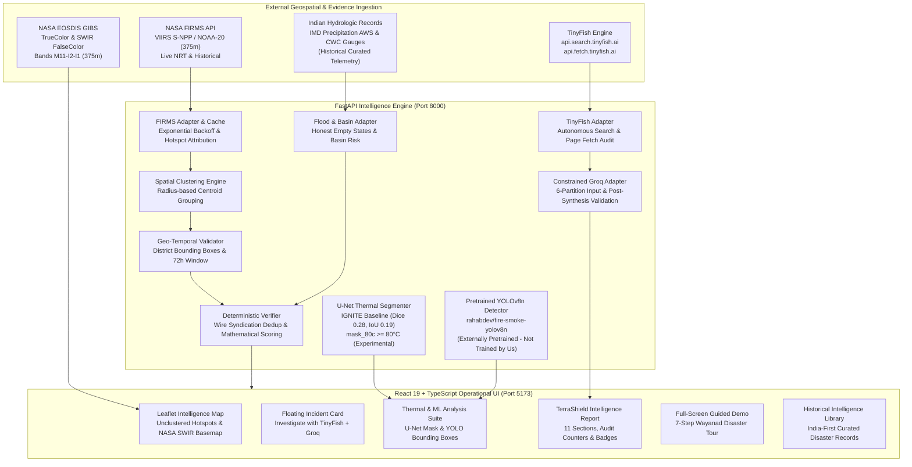

# 🛡️ TerraShield AI — India-First Multi-Hazard Intelligence Platform
## Wildfire + Flood + Thermal Computer Vision + Evidence-Grounded AI

> **TerraShield AI** transforms raw orbital hazard observations into explainable, source-grounded disaster intelligence. Built with an **India-first geospatial focus**, it integrates **NASA FIRMS satellite thermal observations**, **NASA GIBS Shortwave Infrared (SWIR) imagery**, **hydrologic flood intelligence**, **computer vision models (U-Net thermal segmentation & pretrained YOLO fire/smoke detection)**, **TinyFish autonomous web retrieval**, and **Groq Cloud source-grounded intelligence synthesis**.

---

## 📌 1. Product Vision & Architecture

TerraShield AI solves the fundamental credibility gap in disaster dashboards:

1. **Satellite Hotspots ≠ Confirmed Wildfires**:
   - Orbital thermal anomalies trigger from industrial flaring, agricultural stubble burning, and solar reflections.
   - TerraShield displays unclustered raw detections by default, explains sensor footprint limits (VIIRS 375m / MODIS 1km), and explicitly discloses that satellite thermal anomalies alone are unconfirmed ground wildfires until independent field corroboration is established.

2. **Floods Are Non-Combustive (Strict Operational Separation)**:
   - Wildfires and hydrologic inundations are processed through distinct data models and pipelines.
   - **Current Operational Status**: TerraShield features authentic, verified historical disaster dossiers (e.g., Wayanad 2024 debris flow, Chamoli 2021 flash flood) with authentic IMD precipitation telemetry, CWC river gauge records, and KSDMA situation reports.
   - **Live Monitoring Status**: In live monitoring mode, when river gauges report safe stages, the system displays an **honest empty state** ("No qualifying flood anomaly detected in current observation window") rather than fabricating artificial alerts.
   - **Roadmap / Coming Soon**: Fully automated real-time ingestion pipelines for live Central Water Commission (CWC) telemetry and automated Sentinel-1 SAR microwave flood extent mapping are under active development and **not yet fully operational**.

3. **Multi-Tier Thermal Imaging & Computer Vision Hierarchy**:
   - **Level 1 (Operational Satellite Radiometry)**: NASA FIRMS VIIRS (375m) & MODIS (1km) radiometric attributes (Brightness TI4/TI5, Fire Radiative Power in MW, satellite confidence).
   - **Level 2 (Operational Orbital Imagery)**: NASA EOSDIS GIBS False-Color Shortwave Infrared (SWIR Bands M11-I2-I1) and Daily True-Color imagery viewer.
   - **Level 3 (Operational Computer Vision Suite & Transparent Limitations)**:
     - **U-Net Thermal Hot-Region Segmentation**: Custom PyTorch U-Net architecture (`n_channels=1, n_classes=1, bilinear=True`, ~4.3M parameters) trained on the IGNITE thermal fire dataset (`Kyoma001/IGNITE-fire-dataset`, CC BY 4.0) to segment thermal hot regions ($\ge 80^\circ\text{C}$, `mask_80c`).
       - **Reported Test Metrics**: Test Dice **0.276**, Test IoU **0.194** on held-out sequence 0004.
       - **Honest Disclosure**: The model did not converge well and is an **experimental baseline, not production-ready**. It predicts thermal hot regions ($\ge 80^\circ\text{C}$), not confirmed fires. No temperatures or geographic coordinates are fabricated.
     - **Pretrained YOLO Fire & Smoke Detection**: Bounding-box detection for `fire` and `smoke` using Ultralytics YOLOv8n.
       - **Checkpoint Provenance**: Uses an **externally pretrained checkpoint** (`rahabdev/fire-smoke-yolov8n`, Hugging Face, AGPL-3.0). It was **NOT trained by TerraShield**.
     - **Strict Telemetry Isolation**: Thermal AI computer vision outputs are strictly segregated from satellite FIRMS radiometry.

4. **Deterministic Evidence Grounding via TinyFish + Groq Cloud**:
   - **Autonomous Retrieval & Extraction**: TinyFish autonomous search (`api.search.tinyfish.ai`) and page extraction (`api.fetch.tinyfish.ai`).
   - **Strict Semantics & Research Auditing**: Discovered search snippets start as `PARTIAL` and cannot corroborate an event alone; only successfully fetched pages become `ACTIVE`. Real HTTP fetch errors (e.g., 403 paywalls) are recorded and displayed. Auditable metrics track discovered URLs, fetch attempts, successful extractions, failures, relevant sources, and direct vs. contextual sources.
   - **Deterministic Verifier (`verifier.py` & `geo_temporal_validator.py`)**:
     - **Wire Service Syndication Deduplication**: Multiple newspapers reprinting the identical wire dispatch (e.g., PTI, ANI, Reuters, AP) are deduplicated into **1 independent reporting entity**.
     - **Localized Administrative Matching**: Strict bounding box and district-level validation. Broad country matches (e.g., "India") or distant districts are rejected as direct corroboration.
     - **72-Hour Temporal Window**: **Historical articles provide background context only and MUST NOT corroborate a current incident**.
     - **Mathematical Scoring**: Replaces arbitrary constants with dynamic uncertainty and confidence scores grounded in independent source counts, proximity, and official advisories.
   - **Constrained Groq Cloud Synthesis (`groq_adapter.py`)**:
     - Groq receives 6 strictly partitioned input sections (satellite telemetry, direct evidence, contextual history, excluded sources, retrieval audit, deterministic status).
     - **Groq is explicitly prohibited from deciding or upgrading incident corroboration status**.
     - Automated post-synthesis validation ensures that any ungrounded claims are replaced with a safe, evidence-grounded fallback summary.

---

## 🏗️ 2. Architectural Data Flow



---

## 🇮🇳 3. India-First Historical Disaster Library

TerraShield AI includes a curated library of verified real disasters with authentic official documentation:

1. **Wayanad Flash Flood & Debris Disaster (Kerala, July 30, 2024)**:
   - 572 mm / 48h extreme precipitation anomaly at Vythiri AWS station.
   - 8.2 km channelized debris runout along Iruvanipuzha River destroying Chooralmala bridge.
   - Grounded in KSDMA Situation Reports, IMD bulletins, PIB Defence, and verified field reporting.
2. **Chamoli Glacial Rockslide & Flash Flood (Uttarakhand, Feb 7, 2021)**:
   - Ronti peak rock-ice avalanche triggering Rishi Ganga & Dhauli Ganga flash flood.
   - Tapovan Vishnugad hydel project inundation; verified via GSI, ISRO, and NDMA.
3. **Brahmaputra Basin Severe Monsoon Inundation (Assam, June 2024)**:
   - Severe seasonal flooding across 28 districts and Kaziranga National Park.
   - Verified via ASDMA daily flood bulletins and Central Water Commission (CWC) stage data.
4. **Uttarakhand Western Himalayan Forest Fire Complex (Uttarakhand, May 2024)**:
   - Severe pre-monsoon fires across Garhwal & Kumaon pine forests.
   - Peak satellite FRP exceeding 340 MW; verified via Forest Survey of India (FSI) & MoEFCC.
5. **Similipal Biosphere Reserve Fire (Odisha, March 2021)**:
   - High-intensity fires across Mayurbhanj core and buffer zones.
   - Verified via Odisha Forest Department and Principal Chief Conservator of Forests bulletins.
6. **Bandipur Tiger Reserve Fire (Karnataka, Feb 2019)**:
   - Major dry-season forest fire affecting over 4,800 hectares of deciduous forest.
   - Corroborated through Karnataka Forest Department and ISRO Bhuvan satellite monitoring.
7. **International Benchmarks**:
   - Donnie Creek Wildfire Complex (British Columbia, Canada, 2023) — 571,000 ha burn area.
   - Tunnel 5 Columbia River Gorge Fire (Washington/Oregon, USA, 2023).

---

## 🔬 4. The 11-Section TerraShield Intelligence Report

When an analyst clicks **"Investigate with TinyFish + Groq"**, the platform executes full evidence discovery, deterministic verification, and constrained synthesis:

1. **Executive Summary**: High-level synthesis grounded strictly in verified findings and deterministic status.
2. **What Happened**: Objective description of event initiation, location, and progression.
3. **Location and Geographic Context**: Administrative hierarchy, river basin / ecozone, and centroid coordinates.
4. **Event Timeline**: Chronological milestone progression with explicit source attribution.
5. **Satellite and Thermal Observations**: Radiative energy (FRP), brightness temperature, and sensor footprint limitations.
6. **Official Warnings and Independent Corroboration**: Advisories from NDMA/SDMAs, IMD, FSI, and verified journalism.
7. **Documented Impacts**: Casualties, displacement figures, infrastructure damage, and environmental impact.
8. **Response and Mitigation Updates**: Armed forces, NDRF, SDRF, and civil relief deployment.
9. **Evidence Assessment**: Audit counters (discovered, fetched, failed, direct, contextual, independent entities).
10. **Uncertainties, Conflicting Claims, and Data Limitations**: Revisit latency, cloud cover, and AI decision-support boundaries.
11. **Sources and Evidence**: Clickable source links labeled honestly (`OFFICIAL AGENCY`, `VERIFIED JOURNALISM`, `EMERGENCY DISPATCH`, `UNVERIFIED SOURCE`).

---

## 💻 5. Technology Stack & Dependencies

- **Frontend**:
  - React 19 + TypeScript + Vite
  - Leaflet 1.9 + Esri World Imagery + CARTO Dark Matter + NASA EOSDIS GIBS WMTS
  - Lucide React iconography
  - Custom Dark Geospatial Operational Design System (`index.css`)
- **Backend**:
  - Python 3.12 + FastAPI + Uvicorn
  - Pydantic v2 data models
  - HTTPX asynchronous client with exponential backoff & disk caching
  - PyTorch & Torchvision (U-Net thermal segmentation)
  - Ultralytics (YOLOv8n fire/smoke inference)
  - Pillow & NumPy (radiometric image transformation & visualization)
  - Pytest test suite (**63 automated tests passing**)

---

## ⚙️ 6. Environment Configuration (`.env`)

Create or update `.env` in the repository root:

```ini
# NASA FIRMS Satellite Fire Telemetry Key (https://firms.modaps.eosdis.nasa.gov/api/map_key/)
NASA_FIRMS_MAP_KEY=your_firms_map_key_here

# TinyFish Autonomous Web Retrieval Key (https://tinyfish.ai)
TINYFISH_API_KEY=your_tinyfish_key_here

# Groq Cloud High-Speed Inference Key (https://console.groq.com/keys)
GROQ_API_KEY=your_groq_api_key_here
GROQ_MODEL=openai/gpt-oss-120b

# Thermal & ML Model Checkpoints (Optional Overrides)
THERMAL_UNET_CHECKPOINT=backend/ml/models/unet_ignite_best.pt
THERMAL_YOLO_CHECKPOINT=backend/ml/models/yolo_pretrained/best.pt

# Operational Defaults
DATA_MODE=HISTORICAL_SAMPLE
PORT=8000
```

> **Security Guarantee**: All credentials remain strictly server-side. The frontend client never receives secret API keys. Local training data and virtual environments are excluded via `.gitignore`.

---

## 🏃 7. Running the Platform Locally

### Windows (PowerShell)

```powershell
# 1. Start FastAPI Backend (Port 8000)
python -m uvicorn backend.main:app --host 127.0.0.1 --port 8000

# 2. In a separate terminal, start Vite Frontend (Port 5173)
cd frontend
npm install
npm run dev
```

### Linux / macOS

```bash
# 1. Start FastAPI Backend (Port 8000)
python3 -m uvicorn backend.main:app --host 127.0.0.1 --port 8000

# 2. In a separate terminal, start Vite Frontend (Port 5173)
cd frontend
npm install
npm run dev
```

Visit the operational interface at **`http://localhost:5173`** and the interactive FastAPI OpenAPI documentation at **`http://localhost:8000/docs`**.

---

## 🧪 8. Test Execution & Verification

Run the full automated test suite:

```bash
# Run all backend pytest tests (63 automated tests)
python -m pytest tests -v

# Run frontend TypeScript typecheck and production build
cd frontend
npm run build
```

### Verified Test Results (63 Passed, 0 Failed):
- `tests/test_api.py` (15 tests): Health checks, detection pagination, incident grouping, ML status endpoints, and mode switching.
- `tests/test_dossier_and_flood.py` (12 tests): Honest empty flood states, Wayanad disaster demo, historical search, 11-section report schema, thermal capabilities disclosure, and key masking.
- `tests/test_evidence_integrity.py` (11 tests): Zero successful fetch semantics, wire syndication deduplication, out-of-bounds geographic filtering, 72-hour temporal windows, Groq guardrail fallbacks, and unconfirmed hotspot disclosures.
- `tests/test_firms_adapter.py` (12 tests): Live FIRMS URL construction, HTTP 502 exponential retry backoff, disk caching, and attribute normalization.
- `tests/test_tinyfish_adapter.py` (6 tests): Research audit counters, partial vs. active statuses, HTTP 403 error preservation, and localized query generation.
- `tests/test_verifier.py` (7 tests): Haversine distance, temporal window constraints, independent domain deduplication, and mathematical uncertainty calculation.

---

## ⚠️ 9. Scientific Limitations & Ethical Boundaries

1. **Satellite Latency & Revisit Geometry**: Low-Earth-orbit satellites (VIIRS S-NPP / NOAA-20 / MODIS) pass over a location only 2–4 times per 24-hour cycle. Hotspot detections represent an instantaneous orbital snapshot, not real-time video surveillance.
2. **Cloud Cover & Optical Obscuration**: Monsoon cloud cover frequently obscures optical and thermal sensors. Microwave radar (Sentinel-1 SAR) and ground automated weather stations (IMD AWS) are required for all-weather hydrologic monitoring.
3. **Thermal Computer Vision Limitations (Honest Disclosure)**:
   - The U-Net thermal hot-region model trained on IGNITE data achieved **Dice 0.276 / IoU 0.194** on held-out test data. It is an **experimental baseline and must not be used as a production fire detector**.
   - The YOLO fire/smoke detector uses an **externally pretrained checkpoint** (`rahabdev/fire-smoke-yolov8n`) and was **NOT trained by TerraShield**.
   - Standard RGB models cannot be naively assumed to generalize across radiometric long-wave infrared (LWIR) data without domain-specific radiometric calibration.
4. **Flood Feature Operational Boundaries**:
   - Automated real-time streaming of live CWC river stages and automated SAR flood mapping are **roadmap features**. In current live mode, river stages default to an honest empty state when gauges are within safe bounds.
5. **AI Decision Support vs. Command Authority**: Groq Cloud GPT-OSS provides rapid evidence synthesis and discrepancy analysis. It is an analytical decision-support tool, not an official emergency command authority.
